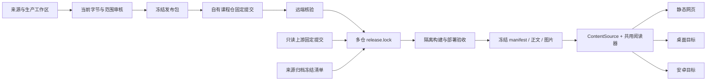

# 00 · 架构总纲

> **文档性质**：阅读器架构规划与实现基线。本文定义目标、契约和边界；标为“现有”的条目依据代码或注明日期的验收证据，标为“目标/待实施”的条目不表示功能已完成。
> **适用范围**：本文是阅读器客户端与 01～05 配套设计的上位依据。[内容发布链](../../CONTENT-RELEASE-PIPELINE.md)负责整个工作区的生产、审核、课程入仓和发布协调，本文规定阅读器如何消费其发布结果。两者职责互补，生产规则不进入阅读器核心。
> **版本**：v5 · 2026-10-11（北京时间）。补齐内容发布与版本契约，校正实现状态、分发、隐私、路线图和验收口径。
> **实施更新**：本轮已落地通用运行时、学习插件、三协议、自有发布协调仓与三端装配；原文中的“当前/尚未”描述保留为实施前基线，最新状态以本文末尾 §12、[运行说明](../IMPLEMENTATION.md) 和 [验收记录](../../acceptance/20261011-implementation/README.md) 为准。原生 M0/M4/M5 的设备验收仍未完成。

---

## 0. 范围声明

### 0.0 修订记录

**v1 → v2 的五处结构性修改**（骨架判断全部保留）：

| # | v1 的判断 | v2 的判断 | 原因 |
|---|---|---|---|
| 1 | 内核是**独立进程**，三端是瘦客户端；需要跨进程协议、双向反向请求、内核二进制跨平台分发 | **取消独立进程**，Agent 运行时是纯 TS 包，跑在同一个 JS 上下文里 | 独立进程只在服务「多端同时在线共享一个内核」时才必要，而该需求已被顺序交付取代。取消后 v1 风险表里最重的三条（R1/R3/R4）同时消失 |
| 2 | 三端（Tauri 桌面 + Web + Capacitor 安卓）**同时规划** | 改为**顺序交付**：PC 框架 → 静态网页 → 安卓；一套代码三种装配 | 顺序交付不需要三端从第一天就参与构建 |
| 3 | 会话存储用 **SQLite** | 改为 **IndexedDB** | 三处行为一致、零原生代码、零迁移脚本。机器状态量小，且不做摘录本，没有需要人读的产物 |
| 4 | 模型层按多厂商通道设计（含「平台额度通道」） | **只做「自定义模型」**：不内置任何厂商、不做账号、不做额度、不托管密钥 | 明确要求 |
| 5 | 面向「作者自己用」 | 面向**分发的用户**：内容默认从 GitHub 取、自动更新、零遥测、免配置可用 | 明确要求「不是给我一个人用的」 |

另两处小幅修正：包管理器改 pnpm + `node-linker=hoisted`（本机 symlink 实测限制，见 §3）；插件装配从「优先级数组」改为「以插件 id 为键的对象」（避免「禁用一项就得重述整个列表」，见 `01` §5.2）。

**v2 → v3：三路并行审查（冲突 / 需求符合性 / 可行性）后的修订**。发现并修掉的问题分三类：

| 类别 | 数量 | 代表问题 |
|---|---|---|
| **事实错误**（拿本机真实内容仓核对后确认） | 4 处 | ① v2 称「102 册无导读节」——**实测 158/158 册都有**，只是标题不同；按标题跳过导读会让这 102 册的 `chapterIndex` 整体偏移，**静默污染线程/进度/引用**。② 早期批次章头是另一套格式（`对应分集 \| 原始标题`），v2 写的字段不存在。③ 册大小范围写错（实为 17.9 KB~283 KB，最大不是 v2 说的那一册）→ 性能基准取错。④ 章 token 数高估约 3 倍 |
| **契约缺口** | 15 项类型 | `LlmAdapter` / `ToolExec` / `JsonSchema` / `Registry` 读面 / 端口方法签名等被引用但从未定义；`QuoteRef` 曾泄漏进核心契约（违反不变量 2） |
| **需求缺口** | 1 项 | **`Thread` 把册/章字段硬编码**，第二个任务无法在不改核心的情况下表达自己的会话范围——直接违反 §1.3「核心不得硬编码业务语义」 |

修订落在各文档：`01` 与 `02` 整份重写，`03`/`04` 定点修正，本文更新路线图与风险表。

**v3 → v4：一次对全部 6 份文档的瘦身审查后，把文档拉回与代码一致**。骨架判断无一改动；改的全是"文档说错了"或"同一件事说了两遍"：

| 类别 | 处数 | 代表问题与修法 |
|---|---|---|
| **会误导改代码的旧口径** | 2 | ① **R11 的切口口径是错的**：v3 写「从导读有序列表条目数派生」，而 `03` §1.3 纪律二写「从正文结构派生」——**代码实现的是后者，且前者已被 `变态心理学 模块06` 实测证伪**（正文 6 章、导读只列 3 条）。照 v3 改代码会把修好的 bug 改回来，已按结构派生改写。② `03` §5.1 把 `dos` 列为映射到 `asm`，实现是 `batch`（DOS 批处理不是汇编语法） |
| **文档与代码不一致** | 9 | 渲染管线图（自研插件实际在 rehype 阶段、`remark-rehype` 已移除、`rehype-shiki` 不存在）、`ContentSource` 接口字段（`capabilities` 已删、`CourseSummary` 漏 `subtitleCount`、`DocumentSummary` 多两个未实现字段）、边界脚本口径（**白名单 → 依赖方向黑名单**）、产物关键词表、TOC 的来源层级、部署描述（双托管）、整册 token 折算、`ephemeral` 表数、打包格式 |
| **文档内部自相矛盾** | 3 | 同一个"整册 token 上限"在三处写成 88k / 94k / 94k；同一册章数在相邻两节写成 10 / 11；字节→token 系数一处"统一 3.2"、一处"中文 3.2 + 拉丁 4" |
| **重复登记** | 5 张表 / 6 项 | 五份文档各有一张未决事项表，编号互撞（「见 D3」有五种含义），6 项被记在两处且已有一条阻塞值漂移 → **收敛为本文 §11 总表**，其余文档只留指针 |
| **应砍的投机设计** | 3 | ① mermaid 渲染器（3 个文件换一个大依赖）② **无语言围栏的启发式探测**——它要解的问题**只有 4 个代码块**（全库 10,764 个块里），而"无语言围栏占比很高"这个前提本身来自一个**统计错误**（用 `grep '^```'` 数，把**闭合围栏**也当成了无语言开围栏；按开/闭状态机重数后是 4 个）③ `$` 误判审计脚本（从未写，真问题是单向的公式失控，已被 `math-guard` 解决） |
| **需求落实缺口** | 1 | 「用组件而非手搓」被写成「组件库 = shadcn/ui」，而实现是 100% 手写 CSS → 按 §3 的**边界**落地：外壳用 shadcn、正文排版自写（并附上为何 shadcn 的默认观感与 `03` §8.1 冲突） |
| **结构调整** | 1 | 静态站从 `apps/reader-web/` 移到**顶层 `github-web/`**，包名 `@app/reader-web` → `@app/github-web`。理由与"为何不与 `apps/` 并列"写在 §4——它不是壳，而是一条并列的分发渠道，也是全项目唯一带自己部署工作流的产物。**刻意不动的一点**：它与 `packages/reader` 的共用关系保持原样——那是「PC 版修了静态版不会漏」的前提，拆开必然漂移 |
| **暗色模式的既有缺陷（顺带修掉）** | 1 | 主题变量原挂在 `.reader-root` 上，而壳层样式一律写 `var(--fg-2, #52525b)` 这类**亮色兜底值**，于是暗色模式下课程页 / 顶栏拿到的是浅色体系的颜色。已把变量提到 `:root`（单一真源）并删掉全部兜底值 |
| **静态站功能补齐** | 1 | 书架改索引式（数字成列、序号走真实策展序列、进度走左竖线）、课程页模块/笔记**并行两栏** + 逐字稿可下载、阅读页向 Typora 靠（左栏四层大纲树 + 册标题为根、册首元信息变两列网格卡、正文左对齐、字号提到 17px）、**顶栏全局标题搜索** + **阅读页册内全文搜索**、**下载当前册 `.md` 与整门课 zip**（自写 zip 容器，零依赖，用 Windows `Expand-Archive` 反验） |

**v4 → v5：对照发布链、当前代码和 10 月 11 日线上复验修订**：

| 修订面 | 本次修订 |
|---|---|
| 架构边界 | 增加生产、审核、课程仓、发布协调、书架构建与客户端的分层；保留纯阅读、可选 AI 和能力端口边界 |
| 内容契约 | 增加仓库角色、稳定身份、发布范围、产品类型、固定提交、正文/资产哈希、旧链接与学科版本约束 |
| 版本一致性 | 增加发布锁、隔离版本目录、缓存失效、进度与会话版本绑定、整批部署及回退要求 |
| 实现状态 | 桌面为 NetPort/SSE 验证界面；Agent、插件运行时和安卓待实施；静态站可用不等于所有里程碑完成 |
| 既有扩展 | 如实记录本地进度与同源阅读事件；修正“零记录”“托盘/更新已就位”“稳定性断言已实现”等旧表述 |
| 验收 | 内容审核、发布包、Git 远端和部署分别留证；规模、性能和历史检查必须绑定日期与输入版本 |

以上 v1～v4 修订记录是**历史决策背景**，其中“当前/已完成”只指当时的检查范围；当前口径以 v5 正文和 §0.3 为准。本次只修订总纲，未实施发布契约或变更部署。

### 0.1 本次文档修订范围

| 项 | 状态 |
|---|---|
| 阅读器总体架构与内容发布边界 | 本文 v5 已更新；契约实现仍待推进 |
| 插件与端口、数据模型、阅读与 AI 细节 | 01～04 已有设计；受本次修订影响的细节见附录 B，不能据此算作代码完成 |
| 构建环境与工具链 | 05 保留历史环境取证；安装、原生构建和分发仍须在目标环境验收 |
| 实现与线上证据 | 归集在 §0.3；未在本次文档修订中重跑产品或全站验收 |

### 0.2 明确的非目标

排除以下方向，避免架构被动膨胀：

- **不做通用 agent**。工具集与提示词由业务插件自带，核心不含任何业务语义。
- **不做第三方插件生态**。插件作者只有一个人——这是后面所有「精简」决策的前提。
- **不做云端模型**。不内置任何模型厂商、不做账号体系、不做额度、不托管密钥。用户自己填一条「自定义模型」。
- **不上 RAG / 向量库**（理由见 §7.3）。
- **不做摘录本、不做学习产出导出**。
- **不做跨端同步**。各形态的会话与进度各自独立，不做云端漫游。
- **不接入第三方遥测、不做账号与登录**。现有自托管阅读事件是按用户要求增加的同源业务记录，边界、部署条件与验收见 §8.5；不再以“零上报”概括所有部署。

### 0.3 当前实现与证据基线

检查日期为 **2026-10-11（北京时间）**，reader 本地分支为 `dev`，代码基线 `32d88fd`（2026-10-05）。代码存在、配置存在、脚本通过与目标平台验收分别记账。

| 能力 | 现有实现 | 当前限制 / 后续验收 |
|---|---|---|
| 共用阅读组件 | 分类书架、整册连续阅读、H1～H4 目录、册内全文搜索、公式、代码高亮、标注与相对图片解析 | React 阅读组件已实现；静态站使用它，桌面产品尚未完成相同装配；跨库搜索目前只搜标题 |
| 静态网页 | 课程导航、主题/行宽偏好、本地已读状态、滚动百分比、正文缓存、单文档与课程 ZIP 下载 | “进入章节/已浏览”不等于读完或课程交付；精确锚点恢复、完整离线启动和含图片的完整课程包尚无闭环验收 |
| 内容接入 | 单仓 GitHubSource、manifest/文件树互为回退、可选同源正文基址 | manifest v2 只有一个全局 repo；未实现固定多仓发布锁与每文档来源回退 |
| 桌面 | Tauri 窗口配置、http 插件、NetPort/SSE 夹具及停止操作 | 入口仍是流式验证界面；无完整 PC 阅读应用、托盘、自动更新、密钥/文件端口验收 |
| Agent / 插件 / 学习交互 | 有 01～04 设计及阅读组件插槽 props | `packages/agent`、`plugin`、`ports`、`app` 与 `plugins/study` 尚未建立；插槽 props 不代表插件注册表、模型适配器或学习技能已实现 |
| 安卓 | 存在图标和 Tauri 通用移动入口标记 | 无 `apps/mobile` 或 Capacitor 应用；这些文件不构成安卓实现或验收 |
| 微信读书支线 | 独立的元数据、个人划线/笔记同步与静态站生成 | 不保存完整书籍正文，不计为本阅读器的全文课程、跨端同步或 AI 内容源实现 |

代码依据：[阅读契约](../packages/reader/src/types.ts)、[内容源](../packages/reader/src/content/github-source.ts)、[静态装配](../github-web/src/App.tsx)、[缓存](../github-web/src/idb-cache.ts)、[下载](../github-web/src/download.ts)、[桌面入口](../apps/desktop/src/App.tsx)、[Rust 壳](../apps/desktop/src-tauri/src/lib.rs)。

[10 月 11 日线上复验](../../acceptance/20261011-online-audit/README.md)覆盖 223 张卡、7,118 份正文：HTTP 均可访问，318 份正文与清单大小不一致，且与活跃 output 文件共享 inode；779 个站内图片地址通过，38 个外站图片仅登记；桌面浏览器抽查 13 页通过。该证据说明静态站已有可用阅读能力，同时存在发布版本漂移；它不证明所有卡片完成内容审核、手机/离线/ZIP/原生客户端验收或新批次发布完成。

规模与生产进度以[统一状态](../../state/content/project-status.json)及其引用证据为准。01～05 中旧批次的 16 门、158 册、273 份切分、283 KB、图片数量等只作历史样本，不能继续作为当前全库事实。

---

## 1. 设计理念：向 dsh 抄什么、不抄什么

dsh（DeepSeek Harness）的架构定义是 *everything is a plugin* —— 一棵 Cordis 插件树，恰好长成了一个 Agent。它的三层分离是：

| 层 | 提供者 | 内容 |
|---|---|---|
| Cordis 运行时 | 元框架 | Context、Fiber（插件生命周期）、Registry、Events（可逆注册） |
| DSH 产品能力 | 官方插件包 | LLM、Session、System Prompt、Tools、Agent Loop、Sandbox / FS / Shell |
| 装配层 | 配置 | Bundle（可复用组合）→ Profile（命名运行时方案）→ Patch（覆盖树，后者胜） |

### 1.1 必须继承的三件事

| 继承项 | 说明 | 对本项目的价值 |
|---|---|---|
| **能力接缝**<br>Service Definition / Provider / Consumer | 三角分离：接口稳定，实现可换，调用方无感 | 换内容来源、换存储、换模型协议时不动业务代码；**也是「一套代码三种形态」成立的前提** |
| **一切皆插件 + 可逆注册** | 工具、视图、提示词、上下文提供者走同一注册入口；卸载即回收 | 这是「可灵活扩展精简」成立的前提，不是加分项 |
| **分层装配** | 基础包 + 场景包 + 用户覆盖 | 换一个 Profile 就换一套 agent 人格与工具集 |

### 1.2 明确不继承的四件事

| 不继承项 | 判断理由 |
|---|---|
| **Cordis 的 Fiber + 依赖注入容器** | 项目以单人维护、面向用户分发为前提，暂不需要多团队共用的 DI 容器。借鉴 `manifest` + `setup(ctx)` + 注册返回注销函数的形状；实现规模与未来迁移成本需实测，不预先承诺代码行数或无成本迁移 |
| **`cordis.patch.yml` 覆盖语法** | 单人项目用「对象深合并 + 插件 id 为键」已经足够，不值得发明一门小语言 |
| **独立服务进程 + 跨进程协议** | 见 §2.1。它只在服务「多端共享一个内核」时才必要 |
| **运行时装第三方插件包** | 动态加载、版本兼容、沙箱、签名、加载失败态——这些正是「不稳定」的主要来源。改为构建期打包（`01` §0） |

> **一句话原则**：抄 dsh 的**架构分层与接缝思想**，不抄它的**元框架实现**。目标是「轻量版 dsh」，不是移植 dsh。

### 1.3 一条比抄 dsh 更重要的约束

既然定位是「只为特定任务优化」，那么 **`system prompt`、工具集、视图、循环策略必须全部是插件产物，核心不得硬编码任何业务语义**。

违反这条，「精简」就只是口号——每加一个新任务都得改核心。

---

## 2. 总体架构

### 2.1 一套代码，三种形态

```
                 ┌──────────────────────────────────────┐
                 │  共用包（TS/React，无原生环境依赖）     │
                 │  reader；agent/plugin/ports 为目标包   │
                 └───────────────┬──────────────────────┘
                                 │ 内容走 ContentSource；原生能力走 Ports
        ┌────────────────────────┼────────────────────────┐
        ▼                        ▼                        ▼
┌───────────────┐      ┌───────────────┐      ┌───────────────┐
│ PC（Tauri 2）  │      │ 静态网页        │      │ 安卓（后续）    │
│ 目标：全功能    │      │ 现有：纯阅读     │      │ 目标：全功能    │
│ fs/net/secret │      │ net 只读       │      │ 各端口原生实现  │
└───────────────┘      └───────────────┘      └───────────────┘
```

**v1 曾把「内核是唯一有状态进程、三端是瘦客户端」当作公理，并由此推出必须造：独立进程 + 跨进程协议 + 双向反向请求 + 内核二进制跨平台分发。这四样全部可以不要。** 逐个核对服务进程到底在提供什么：

| 服务进程的用途 | 还需要吗 | 替代 |
|---|---|---|
| 调模型 | 需要 | HTTP + SSE 流式，**纯 fetch 即可，不需要任何 LLM SDK** |
| 存会话 / 进度 / 书签 | 按产品范围需要 | PC/安卓目标用 IndexedDB；静态站当前已读状态用 localStorage，正文缓存用 IndexedDB；书签/会话为待实施能力 |
| 执行工具（读另一章、册内检索、抽术语） | 需要 | 阅读器本就持有整册内容，**同一个 JS 上下文里直接算** |
| 读写本地目录 / 密钥 | 需要 | **壳的能力端口**（Tauri `fs` / `stronghold`） |
| 前端与后端共享类型 | 不需要了 | 同一份 TypeScript，直接共享 |
| 崩了不影响 UI / 关窗后继续跑 | 不需要 | AI 是次要功能，没有无人值守任务 |
| 多端同时连一个内核 | 不需要 | 顺序交付；且已定「不做跨端同步」 |

**收益是连锁的**：v1 风险表里最重的三条同时消失——R1（内核二进制跨平台分发）、R3（三端同源的两个接缝必须早期设计对）、R4（安卓无法本地跑内核）。

三种形态复用阅读逻辑，各自装配网络、存储与原生能力。静态网页不需要为了阅读而依赖完整 Agent 或桌面壳；PC/安卓的业务交互通过插件与端口扩展。当前实现范围见 §0.3。

### 2.2 分层职责

| 层 | 职责 | 明确不含 |
|---|---|---|
| **共用阅读包** | 阅读模型、Markdown 渲染、React 阅读组件、导航原语、内容接口 | Agent/学习插件、平台壳、原生端口实现、应用外壳组件库；React 本身是已有依赖 |
| **Agent / 插件运行时 / 端口接口** | 会话循环、贡献注册与能力抽象（目标） | 课程生产审核规则、学习业务字段、原生实现 |
| **插件** | 业务能力（工具、视图、提示词、上下文提供者、模型适配器） | 不直接碰端口实现 |
| **壳** | 端口实现、窗口 / 托盘 / 权限、更新 | 不定义生产/学习规则，不保存明文密钥；加密密钥存储由 SecretPort 实现负责 |
| **接缝** | `Ports`（能力）、`ContentSource`（内容） | — |

### 2.3 参考实现对照

本表是目标设计对照，代码落地范围以 §0.3 为准。

| 机制 | 借鉴来源 | 目标设计 |
|---|---|---|
| 会话三原语 | Codex（`Item` / `Turn` / `Thread`） | 沿用，但取消 wire 编码（`02` §2） |
| 插件契约形状 | dsh / cordis（`name` / `inject` / `apply` / `Config`） | `manifest` + `setup(ctx)` + 注册返回注销函数（`01` §1） |
| 上下文稳定性优先 | dsh 的前缀缓存工程化纪律 | 提升为可运行时校验的 `stability` 断言（`01` §2.5、`04` §2.2） |
| Profile 决定工具集 | Zed（Ask / Write / Minimal） | Profile 决定插件装配与 agent 人格（`01` §5.1） |
| MCP 的定位 | 本项目早期协议取舍 | **不作为主协议**，仅保留为可选扩展通道（首版不实现） |
| 端口 + 多壳 | Tauri / Capacitor 生态惯例 | 目标五个端口、三形态装配（`01` §3） |

### 2.4 内容生产与客户端之间的发布边界

工作区由多个独立 Git 仓组成；代码、生产工作区、课程仓和书架是不同层次。根 `.git` 只作工作区标记，不建立包揽所有子仓的父仓。发布基础设施 `tools/`、`subjects.json` 与协调配置的版本归属需要在迁移阶段落实。



上图为**目标链路**。当前书架仍装配部分 output 与原文、部署仍存在可写链接；发布包、发布锁与全批次部署契约尚待实施。

| 层 | 责任 | 不应承担 |
|---|---|---|
| 生产工具 / 工作区 | 来源冻结、计划、写作、下游产品构建 | 直接修改已部署内容 |
| 审核与状态 | 回执绑定当前文件、依赖及来源范围；保存内部证据 | 以文件存在、HTTP 200 或重算哈希代替批准 |
| 自有课程仓 | 保存允许公开的产物、资产、catalog 和范围说明 | 混入任务书、草稿、私有审核记录或密钥 |
| 发布协调 | 核验远端提交、锁定多仓组合、记录发布与部署状态 | 将未锁定的工作副本混入批次；写作或放宽工具终检规则 |
| 书架构建 / 部署 | 消费锁定输入，导出冻结文件，生成导航，整批切换、验收和回退 | 从活跃工作区补位、自动批准正文或共享可写 inode |
| 阅读器 | 读取指定版本、展示来源/范围、校验缓存、发出阅读事件 | 内容审核、Git 推送、发布准入决策或生产状态汇总 |

内容审核通过、发布包有效、Git 远端已核验、线上部署已验收必须独立成立。某课程 v1 已上线而工作区 v2 待审是正常状态；v2 的修改或失效不能悄悄改写线上 v1。完整生产规则以[发布链 §4～§7](../../CONTENT-RELEASE-PIPELINE.md)为准。

---

## 3. 技术选型

本表包含**既有依赖与目标选型**，不是能力完成清单。既有代码范围见 §0.3，目标验收见 §9。

| 层 | 选型 | 理由 | 已排除 |
|---|---|---|---|
| 前端框架 | React 19 + TypeScript + Vite | 三形态通吃；组件库生态最厚 | Vue |
| 应用外壳组件库 | **shadcn/ui + Tailwind**（M1 落地，用于书架 / 设置页 / 对话面板 / 表单这类**交互**部件） | 组件源码复制进项目、可改可删；键盘与可访问性行为开箱即用 | Ant Design（重）、Mantine（体积） |
| 正文排版 | **自写 CSS**（`packages/reader/src/styles.css`），React 组件不引入外壳组件库 | 保持中文文档排版、公式与代码块样式一致；shadcn/ui + Tailwind 属于目标应用外壳，不进入正文渲染包 | 将外壳组件库或平台能力耦合到正文排版 |
| Markdown | unified（remark / rehype）+ KaTeX + Shiki | 需要自定义标注与块锚点，通用渲染器撑不起（`03` §4） | react-markdown 裸用、marked |
| 桌面壳 | **Tauri 2** | 已有窗口与 Rust http 插件；文件、密钥、通知、托盘和更新为后续装配目标。安装包大小、内存与网络行为按目标环境实测 | Electron：当前产品不需要 Node 运行时 |
| 运行形态 | **无独立服务进程**；Agent 运行时为纯 TS 包 | 见 §2.1 | 独立内核 + 协议层 |
| 存储 | IndexedDB（正文缓存已实现；PC/安卓会话目标）；静态站已有 localStorage 阅读状态 | 存储由装配负责，阅读组件不决定落盘策略 | 为机器状态引入 SQLite |
| 密钥 | 目标：桌面 `SecretPort` + Tauri `stronghold` | 尚未接入；模型设置与日志不得存明文密钥 | 明文 JSON |
| 包管理 | **pnpm + `node-linker=hoisted`** | 多包结构标准选择；hoisted 规避本机 symlink 限制（`三端规划与大方向.md` 有实测记录：无开发者模式 → pnpm 符号链接失败） | 若 hoisted 仍失败则回退 npm workspaces |
| 模型接入 | 目标：三个协议适配器（openai-chat-completions / anthropic-messages / google-native），fetch + SSE | 按协议、流式与工具调用能力验收；不保证任意端点均兼容；当前 SSE 夹具不是适配器 | 内置厂商通道、SDK 依赖 |
| 静态站 | Vite + 独立 reader 仓；已有 GitHub/Cloudflare Pages 工作流与自托管装配 | 共用阅读组件；正式多仓发布统一消费冻结版本 | 将课程仓与 reader 合并为一个仓 |
| 安卓 | Capacitor 提供同一套端口 | 只做桥，不碰业务 | Tauri Android |

---

## 4. 包与目录结构

```
video2book-reader/
├─ packages/
│  ├─ reader/       ✅ 纯阅读体验（书架 · 整册渲染 · TOC · 搜索 · 导航原语）
│  ├─ agent/        ⏳ M2 Agent 运行时（Loop · 会话 · 上下文组装 · 工具注册表）
│  ├─ plugin/       ⏳ M1 插件契约与注册表（manifest / 六个贡献点 / 可逆注册 / 装配）
│  ├─ ports/        ⏳ M1 五个能力端口的接口定义
│  └─ app/          ⏳ M1 壳层：导航、视图宿主、插槽宿主、配置、持久化装配
│                   ↑ 目标内置内容源装配归属；GitHubSource 当前在
│                     packages/reader/src/content/，LocalDirSource 待实现
│                     内容源必须在 plugins/ 之外
├─ github-web/      ✅ GitHub 静态阅读站（**刻意放在顶层，不在 apps/ 下**，理由见下）
│  ├─ src/            路由 / 入口 / 搜索 / 样式 / 缓存 / 下载 / ZIP
│  ├─ index.html  vite.config.ts  tsconfig.json  package.json
│  └─ public/         构建产物落点（manifest.json 由 `pnpm gen:manifest` 生成，不提交）
├─ plugins/
│  └─ study/        ⏳ M2 AI 学习交互（划词引用 + 学习技能 + 自定义模型适配器）
├─ apps/
│  ├─ desktop/      ✅ Tauri 窗口配置 + http/NetPort SSE 夹具；PC 产品待 M1，托盘/更新待 M4
│  └─ mobile/       ⏳ M5 安卓
├─ scripts/         ✅ 开发期夹具与一次性工具（含 `verify:boundaries`）
└─ docs/
   ├─ 00-架构总纲.md          ← 本文件
   ├─ 01-插件与端口契约.md
   ├─ 02-数据模型.md
   ├─ 03-阅读器设计.md
   ├─ 04-学习交互设计.md
   └─ 05-构建环境与工具链.md   ← 动手前必读
```

**✅ = 当前目录或代码已存在，不等于里程碑已验收；⏳ = 尚未建立，标注目标里程碑。** 图中 reader 以外的 packages、study 与 mobile 均为目标目录。根工作区的发布协调和书架工具属于独立基础设施，不能仅因本图出现就视为 reader 仓内实现。

**为什么 `github-web/` 在顶层而不是 `apps/` 下**（一处刻意的结构选择）：

`apps/` 下放目标平台壳，要接入能力端口与业务插件。`github-web/` 是共用阅读器的独立静态装配，提供零安装的阅读渠道，已有部署工作流；正式内容更新要经过固定版本构建与验收，不能概括为“推送即生效”。它不需要加载 Agent 或学习插件（不变量 5）。

静态站当前通过 `@app/reader` 与样式入口使用共用包；未来 PC 产品必须复用同一份渲染与派生逻辑，不维护另一份正文渲染副本。内容、缓存和进度由各装配按契约提供，不能将静态 App 的实现等同为 PC 已接入。

### 结构不变量（后续改动不得违反）

1. `packages/agent` 不依赖 `plugins/*`
2. `packages/app` 不依赖 `plugins/*`（前端靠运行时契约，不靠编译期引用）
3. **`packages/reader` 不依赖 agent / 插件 / 端口实现 / 任何壳**
4. **删掉整个 `plugins/`，目标 PC 应用仍能构建、阅读并启动空 Agent 会话界面**；没有 provider 时提示配置/能力缺失，不调用模型。旧“可对话的空 agent”不能解释为无模型适配器也能产生模型回复
5. **删掉 `plugins/` 与 `packages/agent`，`github-web/` 仍能构建并完整可用**，且其产物中**不含划词、`QuoteRef`、模型、会话的任何代码**
6. **正式发布输入和文件保持冻结**：阅读器、缓存与远端回退不得将未锁定工作区或移动分支混入已选择版本；本地预览明确隔离

第 4 条验可精简，第 5 条验静态版不包含 AI，第 6 条验发布一致性；本地阅读状态和同源业务事件不属于 AI 代码。现有 `pnpm verify:boundaries` 检查导入方向、静态构建和产物关键词；当 `plugins/` 与 Agent 尚不存在时，它不能证明注销生命周期、空 Agent 或 PC 产品可用，更不能替代发布锁/文件哈希/线上验收。

---

## 5. 插件系统

完整目标契约见 **`01-插件与端口契约.md`**。插件运行时尚未实现；阅读组件的 props 插槽只是 UI 接缝。此处只记要点：

- 插件 = **构建期打包的可拆装模块**（workspace 包 + 贡献点 + 配置启停），不是运行时装第三方包
- 六个贡献点：`views` / `slots` / `tools` / `context` / `prompts` / `providers`
- 一切注册返回注销函数，卸载逆序回收
- 装配三层：Base → Profile → User，对象深合并，**插件用以 id 为键的对象**
- **按真实消费者增量实现**：没有消费者的贡献点不实现（这是防止机制空转的具体手段）

---

## 6. 会话模型

完整目标定义见 **`02-数据模型.md` §2**。Agent、模型适配器和会话存储尚未实现；本节定义后续实现必须遵守的循环与版本边界，不能从 SSE 夹具推断模型交互已可用。

### 6.1 三原语与 wire

- 三原语 `Item` / `Turn` / `Thread` 沿用 Codex 的形状
- **取消 wire 编码**：无跨进程传输，流式是同进程内的 async iterator
- 记录字段（时间戳、状态、错误）**绝不允许进入上下文前缀区**

### 6.2 Agent Loop（v1/v2 缺失，这里定案）

一个 `Turn` 的执行步骤：

| 步 | 动作 |
|---|---|
| 1 | **组装上下文**：按 `order` 调用全部 `context` 贡献点的 `provide`，得到前缀段与消息段；按 `stability` 校验并生成 `segmentFingerprints` |
| 2 | **发起请求**：调 `LlmAdapter.stream`，把 `text` / `reasoning` 事件逐块追加到当前 `AssistantMessageItem`（`status: 'streaming'`），`usage` 事件写入 `Usage` |
| 3 | **工具轮**：若模型产出 `tool-call`，按 `isConcurrencySafe` 决定并行或串行执行，结果作为 `ToolResultItem` 追加到消息序列，**回到第 1 步**（前缀段不变，只增消息段——这是缓存能命中的原因） |
| 4 | **收敛**：按下表终止条件结束本轮 |

**终止条件**（四种，缺一不可）：

| 条件 | `Turn.status` | 说明 |
|---|---|---|
| 模型 `finishReason === 'stop'`（无工具调用） | `completed` | 正常结束 |
| 工具轮数达到上限（默认 **16** 轮） | `failed` | 提示"达到工具调用上限"。**必须有上限**——否则一个反复调工具的小模型能烧掉一整天的额度 |
| `signal.abort()`（用户点停止） | `aborted` | 任意阶段都生效，包括工具执行中与等待首 token 时；已流出的文本保留（`04` §5.4） |
| 任一失败（网络 / HTTP / 超时） | `failed` | 行为表见 `04` §5.4 |

**三条纪律**：

1. **不自动重试**。重发整段前缀是有成本的，静默重试会让成本数字无法解释（`04` §5.4）。
2. **工具轮回到第 1 步时，前缀段必须逐字节不变**——只有消息段增长。这是"同一轮内多轮工具调用仍能命中缓存"的前提。
3. **`AbortSignal` 贯穿四处**：`LlmAdapter.stream`、`ToolContribution.execute`、`ContextContribution.provide`、`ContentQuery` 的取数。

### 6.3 线程绑定：核心不解释业务字段

`Thread` 只认 `scope: { kind, key }` 与不透明的 `binding`（`02` §2.3）。**「一章一会话」是 v1 学习模块的约定，不是核心规则**——它写在 `plugins/study` 里。

这样第二个任务（例如命理排盘）可以用自己的 `scope.kind` 与 `binding` 组织会话，**不需要改核心一行**。这是 §1.3「核心不得硬编码任何业务语义」在会话模型上的落实，也是「后面还会扩展其他任务」这个要求的验收点（`02` §10 第 9 条）。

### 6.4 学习会话与内容版本绑定（目标）

学习插件的绑定需包含稳定 `course_uid`、`document_uid`、文档内容 SHA-256、章节定位/章节指纹以及取得时的 `release_id`；这些字段由插件解释，核心继续只存不透明 `binding`。仅比较章标题或序号不能发现同标题正文更新。

同一轮 Turn 使用同一份已核验正文快照；工具跨章读取也固定在同一发布版本。发布更新不改写正在执行的上下文。打开新版时，插件比较正文/章节指纹：内容变化则标记旧线程 `stale`，保留历史引用并引导开启新版本会话；只有分类或展示标题元数据变化且正文哈希相同，可继续原上下文，展示变化不得重写既有线程前缀。`release_id` 用于追溯，不因其他课程更新而自动判定本线程过期。具体迁移细节在 02/04 落实，当前仍待实施。

---

## 7. 核心机制：文档上下文注入

完整目标设计见 **`04-学习交互设计.md` §2**。显示整册已实现，AI 上下文注入待 M2；此处只记要点与版本纪律。

### 7.1 显示单位与注入单位分离

| | 单位 | 理由 |
|---|---|---|
| 显示 | **整册**（连续滚动） | 仓库 README：「模块顺序与课程讲授顺序一致，读起来是连贯的教材」 |
| 注入 | **单章**（从当前文档结构派生，不假定每种文章都等于一章） | 每次请求使用已核验的当前章；章大小与 token 折算按本次锁定样本测量，`04` §2.3 的旧数值为历史基线 |

### 7.2 三条硬规则

| 规则 | 说明 |
|---|---|
| **前缀绝对稳定** | 前缀区（系统提示词 + 全册骨架 + 当前章全文）不得含任何易变数据。它是 prompt cache 的命中依据 |
| **划词永远走消息层** | 划词提问作为**新的一条 user 消息**，附带章节路径与原文，而不是回写前缀。回写前缀 = 缓存全废 |
| **确定性序列化** | 前缀区内容由确定性序列化生成，字段顺序固定——顺序抖动同样导致缓存不命中 |

M2 必须将三条规则实现为运行时 `stability` 断言与 `segmentFingerprints` 采集；当前尚无对应运行时。稳定性分组需绑定文档内容版本，不能把不同修订混进同一个比较基线。阅读器解析缓存与 `ContentQuery` 取数同样遵守版本约束；`ContentQuery` 目前只有设计定义，并未作为已实现 API 暴露。

### 7.3 明确不上 RAG

| 判断 | 理由 |
|---|---|
| 不做向量库 / 切片检索 | 本期场景是精读当前文档，采用当前章全文 + 全册骨架，避免新增 embedding 与检索维护链 |
| 何时才评估 RAG | 出现明确的跨文档检索需求、且现有上下文方案无法满足时另行评估；不以全库文档数作为自动启用条件。届时可提供新的 `context` 实现，继续遵守固定内容版本 |

工作区已有 digest / 向量检索支线不等于阅读器已接入 RAG，也不改变本期边界。

> 这条设计的意义：把「要不要 RAG」从架构决策降级为插件替换。

---

## 8. 内容发布、版本消费与产品分发

### 8.1 内容角色与准入边界

正式书架按登记的来源角色消费内容，角色不能由 `*-courses` 后缀推断。四种生产工具对应视频、文本/专栏、聊天、公众号；文章、笔记、教材等是产物维度，不能用“四个专栏”代替全部实施范围。

| 来源角色 | 正式输入与准入依据 | 阅读器呈现 |
|---|---|---|
| `owned_publish`：自有发布仓 | 当前有效审核与工具产品终检支持的冻结发布包；指定远端提交 | 本次批准的正文与资产、公开范围说明、来源与版本 |
| `readonly_upstream`：只读上游 | 登记的上游固定提交与本地兼容/完整性核验 | 上游来源与本地核验范围；不冒充自制内容审核结果 |
| `source_archive`：来源归档 | 冻结来源集合与展示范围 | 原文/逐字稿/语料标识；不计入教材或完整课程完成数 |

现有 `video2book-courses` 按只读上游消费；新增自制视频课程需先登记明确可写的自有目标仓。微信读书仍走元数据/个人笔记站与原站 deepLink，不作为完整书籍正文源。工作区直读仅供隔离预览，不能静默补位正式批次。

来源回执的规范值为 `pass / pass_with_limits / blocked / pending`。受限通过只对明示范围有效；文章批准不自动批准笔记或教材，HTTP 可访问也不等于来源或内容已审。发布协调层调用各生产工具的必需产品门槛，不统一降为“有 Markdown 即可”。

`full_course / selected_scope / single_article` 是**目标交付范围**，部分交付规则尚未实现。未完成规则和验收之前，必需产品门槛继续有效；通过单篇审核只能进入候选，不能自动宣布整门课程完成。内部 GLM 输入、原始回执与取证文件留在验收层；读者只接收公开审核摘要和影响使用的范围说明。

### 8.2 发布链与最小契约

正式新内容的目标链路为：**生产工作区 → 当前审核与产品检查 → 冻结发布包 → 自有课程仓 → 固定提交与远端核验 → 多仓发布锁 → 隔离书架构建 → 整批部署 → 线上验收**。只读上游与来源归档从各自冻结输入接入发布锁，不伪造自制内容批准回执。

以下文件名与字段是**拟新增/扩展契约**，尚未生成或接入运行代码；最终 schema 版本与兼容方案在迁移 B 阶段落实。

| 契约 | 必须锁定的最小信息 | 责任方 |
|---|---|---|
| 仓库登记 | 稳定 `repo_id`、角色、允许目标、catalog 路径与源地址 | 发布基础设施 |
| 工作区发布绑定 | `course_uid`、来源身份/范围、权威修订、跨工作区别名、目标仓与路径 | 内部状态层，不公开私有路径/证据 |
| `publication.json` | schema 版本、课程身份、交付范围、产品类型、相对路径、字节数、内容 SHA-256、依赖指纹与公开摘要 | 自有课程包 |
| `release.lock` | `release_id`、每仓远端提交 SHA、catalog/产品清单哈希、subjects 与身份映射版本、构建器/reader 版本 | 发布协调层 |
| `build-manifest` | 发布版本、正文/资产路径与哈希、来源映射、公开范围、构建校验结果 | 冻结候选目录及验收归档 |
| `deployment-receipt` | 环境、前后版本、manifest 指纹、切换/回退记录、HTTP/正文/图片/旧链接结果与时间 | 验收层 |

正文 SHA-256 与 Git 提交 SHA 分字段记录。包内不写其自身未来提交 SHA，外部发布锁绑定最终提交；部署清单最终哈希由外部回执记录，避免自引用。生成时间使用冻结批次值；相同锁定输入、构建器与配置必须能重建相同正文、资产和清单。

Git 分支是选版本的入口，**固定提交 SHA 才是批次依据**。当前 `dev` 既不证明未发布，也不证明已发布；本地 HEAD 不能替代远端核验。某仓新版本未准备好时，批次可保留该仓上一固定版本或明确排除新内容，不读取当前工作副本补位。

状态分为内容、发布包、Git、部署四组，并绑定工作区修订、包/发布版本及环境。`reviewed_with_limits`、`remote_verified`、`accepted` 等目标状态的详细取值见[发布链 §7](../../CONTENT-RELEASE-PIPELINE.md)；不要与来源门禁值或一个课程 `completed=true` 混用。reader 只展示批次给出的公开状态，不读取私有回执自行判定准入。

### 8.3 阅读器内容契约与兼容迁移

**当前事实**：`Manifest` 只有一个全局 `repo`；`DocumentSummary` 有路径式 `id`、展示 kind 与 size，没有每文档仓库、固定版本和内容哈希。GitHubSource 可先读 manifest 或先取文件树，失败互为回退；同源正文取失败后仍可能落到全局上游回退链。这不足以保障多仓发布一致性。

**目标最小读契约**：

| 信息 | 阅读器必须保持的含义 |
|---|---|
| 发布标识 | `release_id` 与 schema 版本；清单明确声明对应冻结正文/资产和 reader 兼容范围 |
| 稳定身份 | `course_uid`、`document_uid` 不随标题、分类或路径变化；同名跨仓不自动合并 |
| 文档来源 | 文档对应的 `repo_id`、固定 commit、仓内路径，或归档快照定位；部署 URL 与源定位分别记录 |
| 内容指纹 | 正文与引用资产各自的 bytes / SHA-256；内容版本依据指纹，不能以大小代替 |
| 产品与展示 | 保留 `article / textbook / note / transcript / mindmap / asset` 产品类型；`volume / note / subtitle` 是现有显示分组，不能据此统计教材与完成课程 |
| 范围与来源说明 | 整门/选编/单篇、原文或上游、自制审核摘要及受限范围；遗留未审资料显式登记，不标为完整批准 |
| 分类与旧入口 | `subjects.json` 规范身份和映射版本；旧课程/文档 ID 与路径通过显式 alias 保持兼容，不抹去旧稿与新版区别 |

正式客户端优先读取**同源冻结 manifest、正文与资产**。远端回退若启用，只允许访问该文档对应仓的固定提交/归档版本，返回字节仍须匹配哈希；不得把本地课程路径拼到全局上游 `main`。没有准确回退来源时保留同版本缓存或显示不可用，不偷偷换成另一版正文。

结构按发布批次加载，正文与图片按需取得；全量内容校验由候选构建与部署验收负责，客户端对实际取得的内容核验对应指纹，不要求每次启动下载全站。外站图片需在包中明确依赖与可用性边界，未经冻结和取得核验的外链不能计入完整离线资产保证。

`ContentSource` 继续是只读接缝：结构、文档、相对图片基址与搜索结果均属于选定版本；不依赖生产工具或私有审核回执。现有方法签名是否通过增加描述字段或版本化适配器扩展，在 03 中细化；`ContentQuery` 后续实现也必须按同一版本取章/册。

兼容迁移先建立旧 ID→稳定身份映射，保留 v2 输入适配与已有显示分组；新字段和新 schema 接入前，验证旧 reader 对兼容清单的实际行为。旧代码忽略来源/哈希字段时并不会自动具备新契约保证；无法安全处理多仓回退的版本应通过 reader 升级或经验证的同源兼容装配解决，不能伪填一个全局 repo 声称兼容。

新增课程通过**新的已验收发布版本**自动进入书架，不要求每门新增课程重新发布客户端二进制；但移动分支中新出现的未发布目录不能直接进入正式书架。未知学科、身份冲突、引用资产遗漏或路径越界应在候选构建阶段被拒绝，不由客户端猜测修补。

### 8.4 缓存、进度、离线与下载

1. **正文缓存**：目标键至少包含 `document_uid + content_sha256`；取到网络字节先验证后缓存。同长度正文改动也必须失效；同哈希文档跨批次可复用，不能只因其他课程更新就清空全库缓存。当前 IndexedDB 只有正文 content 表，并按 id/size 判断失效，尚未达到目标。
2. **结构与图片**：清单/索引按发布版本缓存，图片按自身哈希或冻结版本 URL 缓存；不能用新版结构解释旧版正文。当前结构 promise 仅在内存，未实现设计中的持久 `remoteIndex` 与完整资产缓存。
3. **阅读进度**：按稳定文档身份、内容版本和位置保存；`blockId` 只是定位提示。正文更新时旧位置保留为旧版本记录，尝试明确映射；无法可靠映射则回退可验证章首并提示，不仅凭旧章序号静默恢复。当前仅有已浏览文档集合、滚动百分比与内存最深章，不等于书签、精确恢复或学习完成。
4. **会话与引用**：遵守 §6.4；线程与引用绑定正文/章节版本。跨发布回退仍可追溯历史，不改写已发生的对话或阅读记录。
5. **离线验收**：完整离线可读需应用入口资源、冻结清单、指定正文与引用资产共同可用，并在重开/断网后实测。已有正文缓存不能独立证明完整离线启动；缓存缺失时应明确说明需联网，保持已缓存内容可读。
6. **下载范围**：按选定发布与批准范围导出正文、引用资产及包清单。完整包应校验文件数量与哈希；任何遗漏需明确列出并标为不完整。当前 ZIP 仅打包课程 documents，不含引用图片，单文件失败会跳过；它是已有便利下载，不能当作完整离线交付验收。

候选批次的清单、正文与资产完成构建/部署校验后才可发布。客户端校验新清单兼容性后选择版本，正文/资产仍按需核验；正在阅读和正在执行的 Turn 保持原快照。回退使用旧批次对应的 reader/清单/正文/资产，缓存按版本隔离；不能只替换 manifest。

### 8.5 分发、更新与数据保存边界

| 面 | 目标与当前状态 |
|---|---|
| 零配置阅读 | 默认提供已验收版本的书架，不要求本机课程目录或模型配置；启动时间按发布样本实测，不预先承诺“秒级” |
| AI 入口 | PC/安卓目标：可见但安静，未配置时引导配置，阅读不受影响；静态站仍不装 AI 或划词引用交互 |
| 桌面安装 | Windows 10/11、Tauri 2 + NSIS 为目标；已有窗口和 `embedBootstrapper` 配置，安装成功、缺 WebView2 环境与离线安装能力均需分别验证，配置不是证据 |
| 客户端升级 | GitHub Releases + Tauri updater/签名校验为 M4 目标；尚未实现 updater、托盘和完整分发验收；代码签名选择见 D5 |
| 内容更新 | 发布协调锁定远端提交并验收新批次后，客户端发现兼容版本；与安装包升级独立，不能把 Git push 当部署完成 |
| 静态分发 | 现有 GitHub Pages 工作流 runtime 优先，Cloudflare manifest 优先，两者均带 manifest 并互为回退；工作流按 main push/定时/手动触发，Cloudflare 有配置条件；自托管另有本地书架装配。这些现状不证明 dev 已发布或正式多仓链已完成 |
| 正式部署 | 在独立版本目录构建并验收 reader、manifest、正文和图片，切换入口后进行线上核对；失败整批回退。禁止与可写 output/课程工作副本共享软/硬链接；静态托管也须发布冻结输入 |
| 本地阅读状态 | 当前 localStorage 保存已读集合、主题、行宽和筛选偏好，IndexedDB 保存正文；属于既有产品扩展，不再要求“关闭即无记录” |
| 同源阅读事件 | 当前 sendBeacon 发送 documentId、chapterIndex、percent、ts 到同源 `/api/reading`；自托管可接落账服务，无服务时阅读不受影响。代码存在不证明服务端接收、保存或聚合已验收；部署说明须记录开关/接收条件、保存位置与期限。版本改造时事件需携带文档/发布版本 |
| 隐私边界 | 无账号登录、不接入第三方遥测；阅读事件不附正文、引用、模型密钥或私有审核材料。客户端状态与同源服务端记录分别说明，不能称所有日志只在本机或零上报 |
| 来源与授权 | 保留每种来源的署名、许可/用途限制、公开范围与免责声明入口；技术审核或发布成功不改变原始授权，不把一份统一声明当作所有来源的发布授权 |

现有实时上游工作流与工作区预览在迁移中显式标为兼容/预览模式；正式冻结模式不得在失败时静默切回移动分支。切换前按 §9 验证旧链接、受限说明、缓存与回退，原有部署行为不会因本次文档修订而自动改变。

---

## 9. 路线图

### 9.1 产品里程碑 M0～M5

| 里程碑 | 目标 | 必须完成的验收 | 2026-10-11 基线 |
|---|---|---|---|
| **M0** | 环境与流式接线 | 在目标 Tauri 环境验证 NetPort 逐块流式、中止与错误；核实 Rust/C++ 工具链和 WebView2 安装条件；记录环境、提交与运行证据 | 代码、窗口配置和 SSE 夹具已建；不凭浏览器夹具或配置宣布原生/干净安装验收通过；05 中环境问题为历史记录 |
| **M1** | PC 框架 + 阅读器 | 建立 app/ports/plugin，只实现有消费者的 views/slots；桌面接入书架、整册、公式、代码、TOC、搜索与版本化进度；全新环境读完一册；按锁定 manifest 选 size 最大的可读文档并记录性能；去插件后仍可阅读与启动空会话界面 | 共用阅读组件已实现；PC 产品装配、端口体系和插件运行时未完成，M1 未整体验收 |
| **M2** | AI 学习交互 | study 章/册会话、划词引用、13 项技能、自定义模型、context/tools/prompts/providers；稳定前缀与内容快照；可观测端点缓存命中 > 0，未知明细与零命中分开；版本更新/中止/工具上限及未配置模型阅读验证 | Agent、study、适配器与稳定性运行时未实现 |
| **M3** | 静态阅读站 | 独立静态装配复用 reader，产物无 Agent/学习插件；以选定发布版本核对全量正文/图片/旧链接，抽查各来源、复杂排版与手机阅读；验证本地状态与同源事件边界、缓存失效、重开离线和下载完整性 | 网站已有可用能力；10 月 11 日 HTTP/浏览器证据已归档，318 份正文版本漂移未消除；固定发布与完整产品验收待补，不能将 M3 全部标为完成 |
| **M4** | 桌面分发与升级 | 原生安装包、GitHub Releases、签名验证、updater/托盘按产品需求接入；干净 Windows 10/11 安装、正常阅读及升级实测；分别记录在线/离线 WebView2 场景，内容更新与二进制升级互不混淆 | 只有部分打包配置；无完整发布/升级验收 |
| **M5** | 安卓完整应用 | Capacitor 装配完整应用 web 代码与平台端口，能读能问；验证固定内容版本、IndexedDB、流式中止、密钥、安装与恢复 | 尚无安卓应用实现 |

| 里程碑 | 实际依赖 |
|---|---|
| M1 | M0 接线与目标环境；共用 reader；内容契约可用适配 |
| M2 | M1 的 views/slots 与 app/ports；context/tools/prompts/providers 在 M2 实现，不能形成自依赖 |
| M3 | 共用 reader 与独立静态装配，不等待完整 PC M1 或 M2；正式冻结版本发布另依赖 §9.2 |
| M4 | M0 + M1 产品与目标平台构建；不以静态网页可用代替原生验收 |
| M5 | M2 完整应用与 M4 分发验证经验；复用应用代码而非无 AI 的静态 App，安卓安装与端口另验 |

M0 验接线，M2 才验模型语义。M3 已先实现部分静态能力，不需要为了保持编号顺序而倒推 M1/M2 完成。每项验收记录代码/内容版本、环境、时间、结果及缺项；旧记录不自动覆盖新增版本。

### 9.2 发布链迁移 A～F（独立工作线，待实施）

阶段定义沿用[发布链 §8](../../CONTENT-RELEASE-PIPELINE.md)，不另造一套完成数字。

| 阶段 | 工作与验收终点 | 与阅读器的关系 |
|---|---|---|
| **A：锁定存量，P0** | 冻结当前清单/正文/图片，记录历史基线、来源角色和旧入口；审查已传播修改的保留/回退，隔离可写 inode；冻结遗留未审资料不等于批准它们 | 保留现有可读版本；为后续身份与缓存迁移取得可靠基线 |
| **B：定义契约** | 明确自制视频可写目标及基础设施版本归属；定义仓库登记、稳定身份、发布包/锁/schema、部分交付准入与兼容测试 | reader 扩展描述字段、固定来源回退、版本化缓存与状态 |
| **C：走通小批次** | 一门具备有效产品审核的课程完成候选包、隔离入仓差异、远端核验、锁定构建、部署与回退证据；同输入可重建 | 验证旧/新 reader、图片、范围说明、旧链接与更新体验 |
| **D：自动装配 catalog** | 遍历登记仓的固定 catalog，新增课程无需修改硬编码列表；处理跨仓身份和学科映射 | 书架来自锁定 catalog，分类变化不改变稳定身份 |
| **E：分批迁移直连** | 每批确定权威正文、批准范围、下游依赖和旧 URL，减少工作区直连；西方马克思主义等分叉单独裁定 | 同时保留线上旧版与待审新版，不把旧链接无条件指向新稿 |
| **F：切换正式发布** | 生产构建只消费 release.lock，冻结版本目录整批部署与回退；工作区/脏课程仓/未锁新提交均不影响线上 | 正式客户端不再静默消费移动分支或活动工作区 |

A/B 是目前优先事项，尚未实施。发布链改造可与 PC/静态产品工作并行；不要求全量登记任务先全部审核完成。新正式内容严格走新链，存量按批次冻结、标识与迁移。

### 9.3 发布与版本契约的验收场景

| 场景 | 通过条件 |
|---|---|
| 新课程与已发布课程更新 | 各完成一次有效发布；旧版冻结可读，新版从当前审核到远端与线上证据可追溯 |
| 内容失效 | 来源/正文/图片变化使依赖包失效；同长度正文变化也不能命中旧缓存或沿用旧批准 |
| 多仓与范围 | 同名跨仓不误合并；受限范围准确展示；某仓未就绪时保留已锁版本，不能混入工作副本 |
| 图片与旧链接 | 包含实际引用资产；路径/分类变化后旧入口可用或明确说明撤回，正文/版本对应关系保持 |
| 部署失败与回退 | 整批 reader/清单/正文/资产回退；已有内容批准、历史会话与失败回执保留，不只改 manifest |
| 客户端兼容与状态 | v2/新契约适配有实际证据；错误远端来源被拒绝；正文更新提示旧进度/会话，元数据变化不误判正文失效 |
| 离线与下载 | 重开断网阅读已缓存包；缺正文/图片或下载失败明确报告，不以进度 100% 宣称完整交付 |

HTTP 200、Git push、边界脚本或一条 accepted 记录均不足以替代上述完整验收。

---

## 10. 风险与权衡

编号保留历史连续性；风险与已排除的架构选择分开。措施是目标约束，是否完成以版本化验收为准。

| # | 风险 | 影响 | 应对 |
|---|---|---|---|
| **R2** | **公式误判**：`$` 与 bash/SQL 变量、长文本冲突 | 部分段落渲染异常 | 复用已有 math-guard，按锁定内容回归公式与普通变量；渲染失败应可定位，不把从未实现的审计脚本算作已有能力 |
| **R3** | **阅读器与 AI 耦合** | 静态装配无法独立运行 | 不变量 3/5 的导入、构建与产物检查；正文版本接口保持只读，不依赖学习插件 |
| **R4** | **插件机制空转** | 前期变慢而收益不明 | 双验收（不变量 4/5）；**按真实消费者增量实现贡献点**，没有消费者的不实现 |
| **R5** | **大文档与复杂排版** | 渲染与滚动体验下降 | 保留连续滚动，不为性能破坏原生选中/复制/Ctrl+F；复用按需高亮；在锁定 manifest 中选最大可读文档并补公式/图片/代码密集样本，记录设备、耗时与内容哈希，不沿用固定 283 KB |
| **R6** | **GitHub/CDN 不可达或限流** | 结构或正文无法加载 | 正式模式优先同源冻结内容与同版本缓存；远端回退仅取锁定仓/提交。现有互为回退不保证双路都失败时仍可启动，持久索引与完整离线仍待验 |
| **R7** | **上游结构变化**（新增、改名、排版差异） | 派生结果和路径变化 | 上游更新先固定提交并在候选构建验证 catalog/清单及别名；正文解析容错，不能绕过发布准入直接消费实时文件树 |
| **R8** | 本地 IndexedDB/localStorage 被清理或配额不足 | 缓存、进度或未来会话丢失；离线不可用 | 存储失败不阻断在线阅读；缺失缓存明确提示需联网。会话/进度备份见 D12，不承诺内容随时可离线重建 |
| **R9** | prompt cache 稳定性与端点能力不同 | 成本或命中率不可解释 | M2 实现并采集 segmentFingerprints；稳定性和可观测命中分开验，改变前缀策略需重新验证，不将规划当作当前能力 |
| **R10** | 单人维护 reader 多包及工作区多个 Git 仓 | 版本组合与维护负担 | reader 是目标 pnpm 多包仓，整个工作区是独立 Git 仓集合；仅建设有消费者的包，发布锁记录多仓组合，不把目标 5 packages/2 apps/1 plugin 当现有数量 |
| **R11** | **章序号派生与改版位置迁移脆弱** | 进度、引用和会话静默错位 | 从正文 H2 结构派生，标题只辅助识别导读/小结，导读条目数不是权威；已有旧样本曾出现正文 6 章而导读 3 条。对选定发布重新运行 check:split，记录覆盖与结果；位置/线程再绑定内容版本，不能凭旧“273 份 0 失配”宣布当前全库通过 |
| **R12** | **端点不报告缓存明细**（本地反代、Ollama、多数中转站），"命中率"不可观测 | 成本面板数字缺失；M2 验收项无法判定 | 已定案：`cachedPrefixTokens = -1` 表示未知，与 0 分开显示；M2 验收拆成"前缀稳定性必过 + 命中率在可观测端点上测"（`04` §6.3） |
| **R13** | **本地目录授权与自定义模型网络权限** | 端口接入与权限不一致 | 01 §3.2 保留壳侧授权方案；文件端口、用户端点、scope 配置与错误恢复需在实际 Tauri/Capacitor 环境验证，当前只有最小 http 接入 |
| **R14** | **工具调用轮数失控** | 成本增加 | M2 实现默认 16 轮上限、failed 提示与贯穿中止；不自动重试，当前无 Agent Loop 实现 |
| **R15 / P0** | **部署与活跃工作区共享 inode/链接**，10 月 11 日已有 318 份漂移证据 | 未经发布的编辑直接影响线上，清单与正文分离 | 先冻结当前与历史字节，审核保留/回退，再改独立版本目录；不能仅刷新 size 或补哈希当作批准 |
| **R16** | **按 size、路径或章标题判断版本** | 同长度更新不失效、同名跨仓命中错误缓存、旧会话引用新版 | 稳定身份 + 正文/资产 SHA-256；按 §6.4/§8.4 隔离版本，验证同长度改动与元数据更新 |
| **R17** | **多仓来源和仓库角色混淆** | 只读上游被写入，回退错误仓，分类/改名破坏旧链接 | 登记 repo_id/角色/允许目标，逐仓固定提交；catalog 与 subjects 显式映射，别名与跨仓冲突检查 |
| **R18** | **只部署清单或多仓更新半途失败** | 混合版本、不可复现、无法完整回退 | release.lock 固定组合，整批 reader/清单/正文/资产验收与回退；未就绪仓保留已锁旧版 |
| **R19** | **记录策略与部署说明漂移** | 用户不清楚本地与服务端保存范围 | 如实说明 localStorage 与同源事件，部署记录接收条件/保存策略，版本化事件；无第三方遥测和私有数据载荷 |
| **R20** | **批准范围、产品类型与数量混为完成度** | 单篇/原文被统计成完整课程，受限来源被误标通过 | 产品与展示分开，公开范围随包保存；内容、包、Git、部署独立记账。原始返回文件哈希一致也不等于其取证来源完整 |

**已排除的架构风险与保留的验证边界**：

| # | 原风险 | 为何不再是风险 |
|---|---|---|
| ~~R1~~ | Tauri http 是否存在流式能力 | 历史检查读取依赖源码确认流式通道存在；M0 仍须在目标原生环境验证当前依赖版本、逐块响应与中止。依赖源码可行性不是本项目原生运行通过 |
| ~~v1-R1~~ | 内核二进制跨平台分发 | 取消独立进程后不存在 |
| ~~v1-R3~~ | 三端必须同时实现全部接缝 | 改为顺序交付，取消跨进程接缝；内容契约与能力端口仍分别需要验证 |
| ~~v1-R4~~ | 安卓无法本地跑内核 | 没有内核进程要跑；安卓提供自己的端口实现 |

> 编号沿用历史；已关闭编号不回收，新增实际发布风险从 R15 起登记。

---

## 11. 未决事项（**总表 —— 唯一权威**）

**阅读器相关未决事项只在这里编号。** 01～05 只写指针；工作区发布操作与迁移任务沿用发布链/统一状态，不在这里复制一套完成台账。

理由：原先五份文档各有一张 D 表，编号互撞（于是「见 D3」有五种含义），且同一件事被记在两处（逐字稿、跨库检索、脑图、Profile 清单、技能提示词各重复一次，其中"逐字稿"在两处的阻塞值已经漂了）。**重复登记的必然结局就是漂移。**

| # | 事项 | 阻塞 | 备注 |
|---|---|---|---|
| D1 | 13 项技能的最终提示词文本（9 项划词 + 4 项章/册） | M2 | 技能表已定（`04` §4.2 / §4.3），指令正文需逐条打磨 |
| D2 | 笔记到逐字稿片段的关联定位 | 后续 | 逐字稿不做独立阅读视图的决定保留；已有列表/下载。部分来源块是 Markdown，范围与片段映射另定，不能凭文件后缀或旧 741 份样本概括全库 |
| D3 | 跨库**全文**检索技术方案 | 后续 | 已有顶栏标题搜索与册内全文搜索；跨库正文索引尚未实现。新索引必须来自锁定发布，遵守产品类型/公开范围与版本更新 |
| D4 | 知识拓扑脑图视图 | 后续 | 导图产物存在不等于 reader 已有交互脑图；Markmap 等方案另验 |
| D5 | 是否购买代码签名证书 | M4 | 签名与安装提示按目标 Windows 环境、分发渠道和成本决定；不能预先保证所有机器均可手动放行 |
| D6 | Profile 的具体组合清单（`reader` / `full` / 将来的第二业务插件） | M2 | 待第二个业务插件出现时定 |
| D7 | 安卓端是否复用 PC 的同一份构建产物 | M5 | 预期是（`apps/desktop` 的 web 代码 + Capacitor 端口），但需实测 Capacitor 对 IndexedDB 与流式的支持 |
| D9 | 是否将边界与新版本契约回归加入 CI | M1 / B～C | 已有 GitHub Actions 部署工作流；边界脚本当前本地执行。部署 CI 不等于架构/发布契约已自动验收 |
| D10 | 插件的热重载（开发期效率） | 待定 | 单人开发时价值高，但会引入状态残留问题；先靠 Vite HMR + 手动重启（`01` §10） |
| D11 | `stability` 诊断队列是否要落盘（跨会话保留） | 后续 | M2 首版目标为内存诊断与成本面板；当前尚无实现（`01` §2.5） |
| D12 | 是否要「导出机器状态为 JSON」以备换机 | 后续 | 与“不做摘录本”不冲突；状态备份方案另定（`02` §11） |
| D13 | 多模型的并发使用：一条线程固定一个模型，还是可中途切换 | M2 | 中途切换会破坏前缀缓存，倾向于「线程固定模型」（`modelRef` 已是线程级字段） |
| D14 | `Thread.binding` 的插件侧迁移是否需要一个通用钩子 | 后续 | 首版目标由插件按 schemaVersion 处理；内容版本绑定与 stale 规则已定，通用钩子不是其实施前提 |
| D15 | 笔记与册的对照阅读（同一主题的笔记 vs 全书） | 后续 | “考前速查用笔记”是明确场景（`03` §13） |
| D16 | 打印 / 导出 PDF（仓库 README 提到「打印装订」） | 待定 | 口径已澄清：它是**源内容的呈现**，不是「学习产出导出」，因此与 §0.2 的排除项不冲突 |
| D17 | 记忆卡（技能 8）是否落地成可复习的卡片队列 | 后续 | 首版技能目标为“就地翻面”（`04` §4.2），尚未实现 |
| D18 | 自测题是否记录作答历史形成复习队列 | 后续 | 与阅读/章级进度是不同模型，需先验证真实使用 |
| D19 | 非 ASCII 项目路径在 MSVC 与 M4 打包（NSIS / 签名）下是否真无问题 | M4 | 05 §6 保留旧环境的 GNU 路径问题；实际目标工具链、路径与打包分别实测，不从历史失败泛化到所有环境 |
| D20 | 是否保留 GNU 工具链 | M0 后 | 依据实际机器环境与 MSVC 验收决定，05 的体积与环境记录为历史样本 |
| D21 | 自制视频发布目标及发布基础设施的 Git 归属 | B | 现有上游保持只读；明确可写目标与 tools/subjects/协调配置所属仓，不创建工作区父仓替代多仓发布锁 |
| D22 | 单篇/选编准入与取证限制的发布政策 | B～C | 三种交付范围和有效审核原则已定；各工具必需产品、受限来源与原始返回取证不足时如何准入需落实，规则完成前只进候选 |
| D23 | manifest/schema 版本、兼容窗口与 alias 迁移格式 | B～C / M1～M3 | 稳定身份、逐文档来源、内容哈希及冻结版本原则已定；细化字段、旧 reader 验证、cache/事件/线程迁移与不兼容提示 |
| D24 | 各部署的同源阅读事件接收和保存策略 | M3 | 保留既有扩展；明确部署条件/开关、保存位置/期限与版本字段，服务端验收不能由 sendBeacon 代码存在代替 |
| D25 | 是否扩展图片相关 AI 能力 | 后续，非当前范围 | 旧“仅两处坏引用”的关闭前提已不适用于当前书架；图片阅读/发布完整性必须实施，图片送入模型另行决策，不自动扩大 M2 |

**D8 位置空缺**：原「段落级高亮是否要做」已定案不做（见下表），编号不再回收——**编号一经分配不复用**，否则任何旧引用都会指向另一件事。

**已关闭（保留记录，不占编号）**：

| 原事项 | 结论 |
|---|---|
| `Registry` 是否需要只读查询面 | **已定案：需要**——装配要枚举、晚注册要能触发重渲染，`list` + `subscribe` 都是必需的（`01` §2.1） |
| `progress` 的 `blockId` 是否要持久化 | **目标已定：存，但只当提示**；绑定正文版本，失效回退可验证章首（§8.4）。当前静态装配未持久化/恢复精确锚点，02/03 的旧规则需同步 |
| 段落级高亮 / 高亮的删除与合并策略 | **已定案：不做**（用户明确）。`highlights` 表、`onHighlightCreate`、`HighlightRef`、`onBookmarkToggle` 之外的划词相关事件均已从设计与数据模型中移除（`03` §13、`02` §4） |
| 是否允许「不引用任何段落，直接就整章提问」 | **已定案：允许**——就是 `scope: 'chapter'` 的 4 项技能（`04` §4.3），不需要额外机制 |
| 多模态：模型支持图片时是否把图送进去 | **历史关闭前提失效，转 D25**。10 月 11 日证据已检查 779 个站内图片地址；现有相对图片渲染与发布资产保证必须保留，当前不新增模型图片输入承诺 |

---

## 附录 A · 决策速查

| 决策 | 结论 |
|---|---|
| 抄 dsh 什么 | 能力接缝、一切皆插件 + 可逆注册、分层装配、前缀缓存纪律 |
| 不抄 dsh 什么 | Cordis Fiber / DI 容器、`cordis.patch.yml` 覆盖语法、独立进程 + 协议层、运行时装包 |
| 运行形态 | 共用阅读包三种装配；**无独立 Agent 服务进程**；内容走 ContentSource，原生能力走 Ports；同源阅读落账服务是独立部署能力 |
| 前端框架 | React 19 + TS + Vite |
| 组件库的边界 | reader 已用 React + 自写正文 CSS；目标 app 外壳用 shadcn/ui + Tailwind，外壳组件库与原生能力不进入阅读包 |
| 桌面壳 | Tauri 2（Windows 10/11） |
| 会话模型（目标） | `Item` / `Turn` / `Thread`，**取消 wire 编码**；核心只认 `scope: {kind,key}` + 不透明 `binding`；**「一章一会话」是 v1 学习模块的约定，不在核心** |
| Agent Loop（目标） | 组装上下文 → 流式请求 → 有工具调用就执行并回到组装（前缀段不变）→ 四种终止（正常 / 工具轮上限 16 / 用户中止 / 失败）；**不自动重试** |
| 存储 | 当前静态正文用 IndexedDB，阅读集合/偏好用 localStorage；PC/安卓目标用 StorePort，静态会话不装载；版本缓存与精确位置见 §8.4 |
| 端口 | 目标 5 个（fs/net/secret/store/notify）；现有桌面仅最小 http/NetPort；静态当前直接装配 fetch 与缓存，不算完成五端口替换；notify 无消费者则推迟 |
| 内容源放哪 | 内置且独立于学习插件；GitHubSource 当前在 reader/src/content，目标 app 负责装配，LocalDirSource 待实现 |
| 密钥在哪 | 目标 SecretPort + Tauri stronghold，尚未接入；配置、事件和日志不得包含明文密钥 |
| 内容从哪来 | 正式目标为多仓固定版本的同源冻结清单/正文/资产；现有 GitHub 实时/manifest 回退作为迁移基线，本地工作区预览隔离 |
| 内容身份与状态 | 稳定 UID、每文档来源/哈希、真实产品类型、批准范围；内容/包/Git/部署独立记账，volume 展示位不是教材计数 |
| 文档怎么进上下文 | 显示整册已实现；目标注入单章、绑定正文版本；前缀稳定、划词走消息层，Agent/ContentQuery 待实施 |
| 要不要 RAG | 本期不上；有明确跨文档需求且现有上下文不能满足时另评估，可新增 context 实现，不按全库数量自动启用 |
| 模型接入 | 目标只做“自定义模型”的三个协议适配器；尚未实现，不内置厂商、不做账号、不托管密钥 |
| 分发与更新 | 静态渠道已可用；内容经 release.lock 与整批部署/回退更新，二进制 Releases/updater 属 M4 待实施；安装配置不能代替实测 |
| 隐私 | 无第三方遥测/账号/登录；已有本地状态与同源业务事件分别说明，接收/保存策略见 D24 |
| 「可精简」怎么验收 | 去插件后目标 PC 可阅读并启动空会话界面，无 provider 不调用模型；静态构建无 AI。现有边界脚本只覆盖部分，不证明未建运行时的注销与 PC 验收 |
| 「可扩展」怎么验收 | 新增一个假想的第二插件，能用**自己的** `scope.kind` 与 `binding` 建线程，且不改 `packages/agent` 与 `packages/plugin` 一行（`02` §10 第 9 条） |

---

## 附录 B · 配套文档同步与验收依据

本次完整修订对象为 **00 总纲**。01～05 的现有版本尚未同步以下细节；实现前按本表落实，冲突时以本文 v5 的阅读器边界及发布链的生产规则为准，不把此表视为配套文件已更新。

| 文件 | 待同步位置与要点 |
|---|---|
| `01-插件与端口契约.md` | §2 内容查询/执行接缝、§3 端口与静态存储装配、§6 内置源、§8 边界验收：固定版本取数、实际包归属、无 provider 空会话、已建与未建机制分开 |
| `02-数据模型.md` | §1 身份、§2.3～2.4 binding/stale、§4 持久化、§9 迁移、§10 验收：稳定 UID/内容指纹、旧状态迁移、正文与元数据更新区别；去掉静态进度一律内存与仅章标题判改版的旧口径 |
| `03-阅读器设计.md` | §2 内容源/manifest/缓存、§3 分类、§7 图片、§9 位置与 ContentQuery、§10 性能、§11～12 静态分发/验收：多仓冻结输入、版本回退、图片/ZIP完整性、同源事件与本地状态；旧样本数字标日期 |
| `04-学习交互设计.md` | §2 上下文、§5 会话/流式、§6 成本验收：绑定正文版本、工具同批次读取、更新提示与历史引用；注明技能/指纹/缓存面板仍是规划 |
| `05-构建环境与工具链.md` | 目标环境、原生构建与安装验收：历史工具链故障与当前环境分开，区分配置、构建、在线/离线安装、升级实测；不由图标推断安卓实现 |

可复核依据：[完整发布链](../../CONTENT-RELEASE-PIPELINE.md)、[统一状态](../../state/content/project-status.json)、[线上复验及原始证据](../../acceptance/20261011-online-audit/README.md)、[现有部署工作流](../.github/workflows/deploy-reader.yml)、[边界脚本实际覆盖](../scripts/verify-boundaries.mjs)。这些证据分别回答生产/发布规则、当前队列、线上字节、部署配置和部分依赖边界，互不替代。


## 12. 本地实施状态（2026-10-11）

代码、冻结产物与验收回执已可审阅；本轮只在工作区运行，不推送、不改生产服务。完整命令与接缝见 [IMPLEMENTATION.md](../IMPLEMENTATION.md)，实际测试口径见 [验收记录](../../acceptance/20261011-implementation/README.md)。

| 层/里程碑 | 已实现并验证 | 仍须单独验收 |
| --- | --- | --- |
| 发布链 A/B/D/F | 本地自有仓与协调仓、准入/哈希/范围、固定提交锁、自动 catalog 发现、v3、整批本地 HTTP 验收/回退、同锁重建 | C 的真实整课批准发布、E 的逐门迁移、真实远端/生产验收 |
| M0 | 桌面原生 NetPort 接缝和 SSE 冒烟入口；浏览器协议夹具验证逐块/停止 | Windows WebView 中当前 Tauri 依赖真实流式、取消、localhost 与安全存储 |
| M1 | agent/plugin/ports/app 包，六类可逆注册、懒激活、通用 scope/不透明 binding、第二业务插件回归；删插件三端仍构建 | 原生外壳下卸载与本地目录的运行证据 |
| M2 | 13 项初版提示词、版本绑定会话、四个同批次只读工具、逐字输出/停止、前缀诊断、未知缓存显示、划词消息附件/历史重放、翻面；三协议流夹具 | 实际模型端点、真实 usage/缓存命中、提示词使用效果 |
| M3 | shared reading、v3 同源固定内容、SHA 缓存校验、进度与 stale、图片/ZIP、静态离线重开；无 AI 核心/插件构建通过 | 外部宿主、v3 切换与保留版本路由、D24 事件接收/保存 |
| M4 | 托盘隐藏/恢复、Stronghold+OS keyring、AppData FsPort、选定目录只读句柄、可选签名 updater 接缝、手动候选构建 CI | Rust/NSIS 编译、Win10/11 安装、vault 锁定恢复、代码签名/真实升级 |
| M5 | Capacitor Android 工程、共用学习/阅读外壳、原生增量流/中止、Keystore、filesystem；前端构建与 cap sync 通过，小屏浏览器验收通过 | APK 编译、安卓 WebView/真机、后台/重启/网络中止/密钥运行验收 |

D 表的当前裁定：D1 已提供 13 项初版文本，真实使用继续迭代；D6 采用 reader/full 学习插件开关，模型独立选配；D7 共用 packages/app 与 reader 的源码、分别装配端口和构建产物；D9 已写合同/边界/手动原生候选工作流，未推送运行；D11 内存前缀诊断与成本面板已实现、落盘仍后续；D13 线程固定模型身份，模型/端点/协议改变创建不同身份，凭据轮换保留；D17 已实现就地翻面，复习队列未扩展。

D21 本地所有权已落实：自制视频写 video2book-owned-courses；subjects、协调配置/代码、只读门禁适配归 video2book-release；生产引擎仍归四个工具仓；父 Git 为空，远端稍后重建。D22 full_course 必需产品和受限来源公开披露已生效，部分交付策略未启用，unverified 模型原始返回取证只进候选。D23 本期正式只接受 v3（兼容 [3,3]），旧 ID 显式 aliases，正文 SHA 绑定缓存/位置/线程；v2 只能显式隔离预览。D24 默认关闭事件上报、接收服务未部署。D25 未扩大图片 AI 能力。

存量正文保留 legacy_unreviewed；尚不能从 volume 展示位核实产品类型时使用 `legacy_unknown`，只允许 source_archive。该占位不计入教材批准，也不允许新自制包使用。

01～05 已各追加本轮实现同步说明；历史数字、环境问题和目标设计仍保留为有日期的基线。上述代码与浏览器验收不能关闭原生 M0/M4/M5，也不能关闭真实新整课批准与外部发布验收。

### 12.1 指定真实课程的后续进展

同日后续已用 BV1zb4y1a7JU 唯一 P01 完成四产品重新全文审核，来源经官方身份及真实 ASR 核对，公开 `reviewed_with_limits`；已完成自有本地仓、固定提交、冻结构建、同锁重建和 HTTP 验收。C 的真实本地课程发布已补齐，外部发布仍未执行。真实 GLM 的 Agent/学习工具/引用/用量/停止与恢复也已执行，不再仅有模型夹具。

已在 /tmp 建立官方 JDK21/Android SDK36 工具链，并实际编译包含本课的安卓 debug APK；M5 的 APK 编译项已补齐。新增冻结演示内容打包入口和 Windows 构建脚本，模型设置可填写可选参数 JSON。同日后续已在 DESKTOP-MTIEUSU Windows11 完成原生编译、NSIS 安装和 13 项原生检查，包括真实 Tauri HTTP 流、学习工具、Stronghold 保存与跨进程密钥/线程恢复；首次构建暴露的两条无效 fs 权限名已修正。Windows 设备验收仍为 partial，剩余托盘/停止/后台/完整离线冷启动等项与安卓真机、签名升级仍待设备回执，不据部分通过关闭 M0/M4/M5。当前证据与安装包入口见[真实课程验收记录](../../acceptance/20261011-hard-brain-real/README.md)。


### 12.2 iPhone 主屏幕网页

依用户要求，M3 静态阅读装配新增 iOS 主屏幕元数据/图标/standalone清单、Safari16.4构建目标、安全区域和动态视口。冻结课程经相同SHA校验装入独立网页；离线壳安装时预缓存全部四产品，不要求先逐本打开。通过9项HTTPS/手机视口/首次离线正文检查，已由 xueqiu 的 Tailscale Serve 在后台提供私有HTTPS地址。真实iPhone主屏幕安装仍待用户操作，不以Chromium移动视口代替Safari验收；不增加web端模型、原生SDK或公网发布。记录见上述真实课程验收目录。
